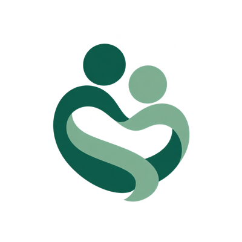
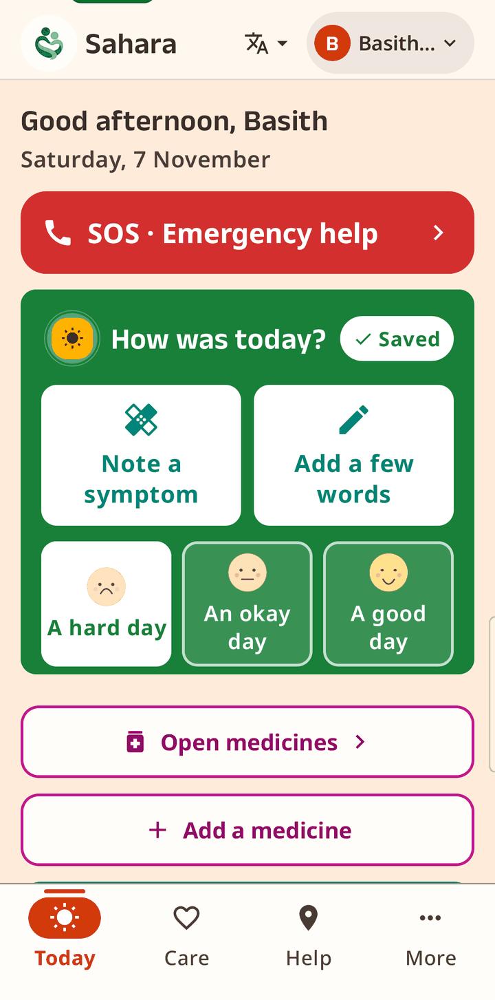
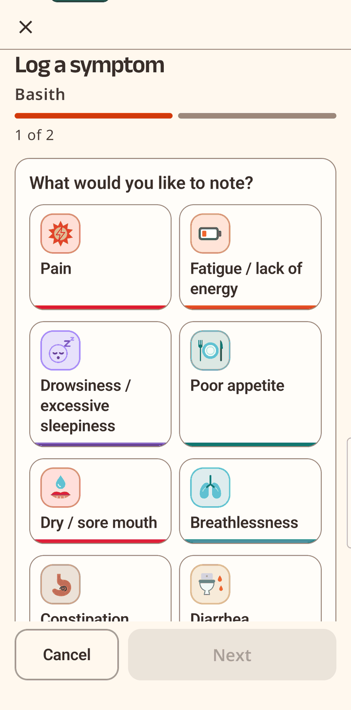
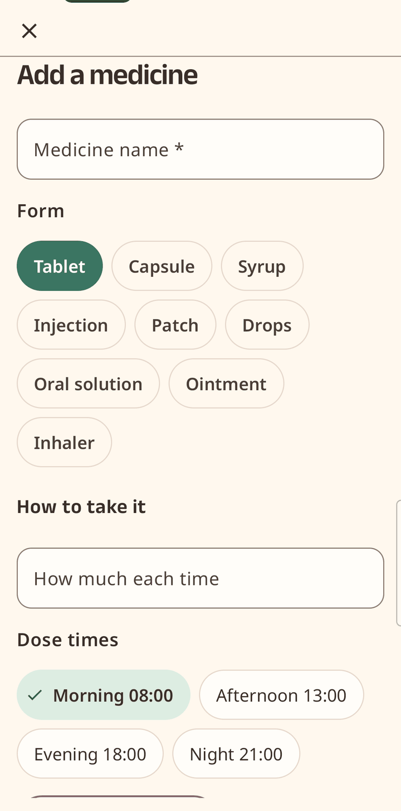
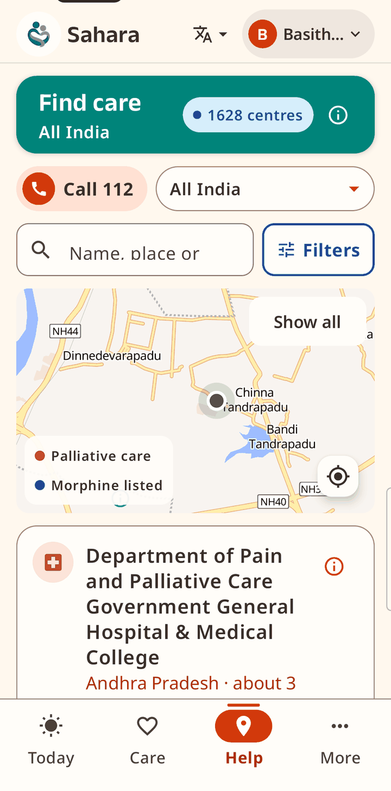
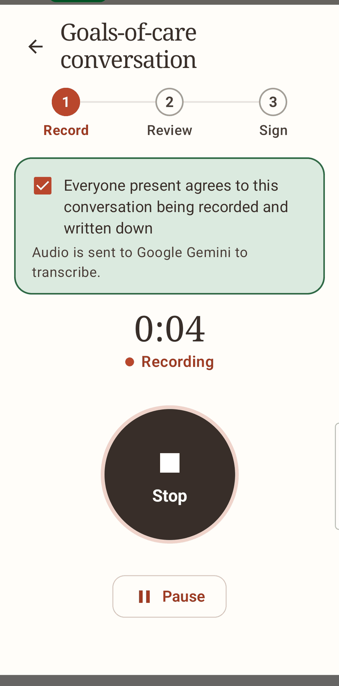
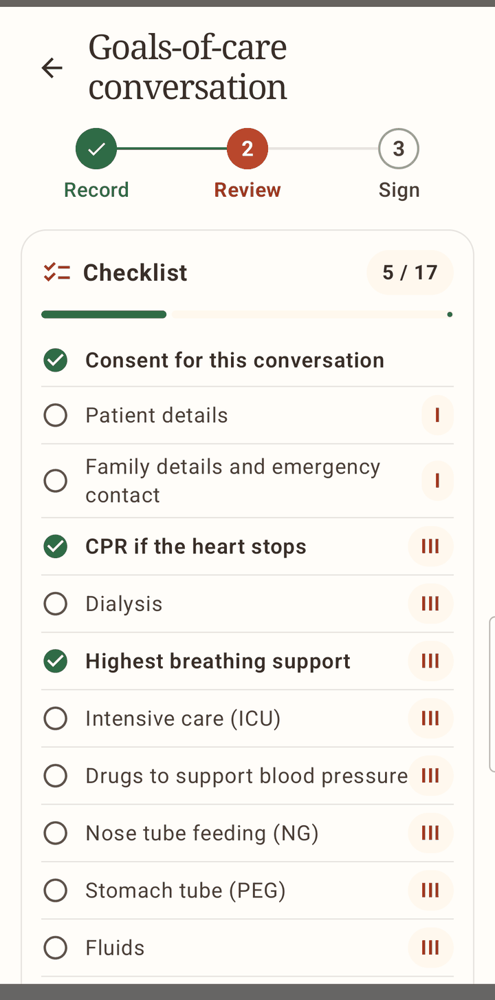
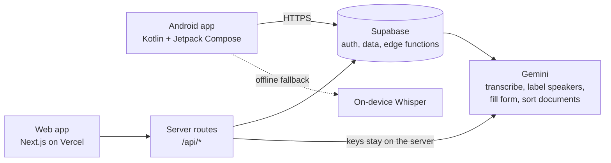

<p align="center">
  
</p>

<h1 align="center">Sahara</h1>
<p align="center"><b>A palliative-care companion for patients, families and their doctors.</b><br>
Record what matters, track how you feel, and find help nearby. On Android and the web.</p>

<p align="center">
  <a href="https://sahara.wedevit.in"></a>
  <a href="https://play.google.com/store/apps/details?id=in.wedevit.sahara"></a>
  
  
</p>

<p align="center">
  
</p>

## The problem

- **98%** of India's metastatic (advanced) cancer patients had unmet palliative-care needs (Patil, *BMJ Support Palliat Care* 2024). Timely referral was only **30 to 37%** at two centres (Venketeswaran, *BMJ Support Palliat Care* 2026).
- **Goals of care** (CPR, ventilation, ICU, place of death) are rarely written down: in one hospital only **41%** of cancer patients dying on active treatment had end-of-life care documented (Das, *Cancer Med* 2026), though **88%** of urban adults want this choice (Living Will Survey, IndiaSpend 2019).
- **Symptoms** change between visits and are often missed. Patients who report symptoms online have better quality of life and fewer emergency visits (Basch, *J Clin Oncol* 2016).
- **Pain relief:** India uses 0.11 mg of morphine per person against 6.27 mg globally (Rajagopal, *J Glob Oncol* 2017), and families rarely know where to find it.

> A 62-year-old woman with advanced breast cancer tells her doctor her wishes. Two months later she is unconscious in the emergency department, her children disagree about CPR, and nobody can find what she said.

Sahara helps patients and caregivers align care with their values and needs.

## What Sahara does

| | |
|---|---|
| **Goals of care** | The doctor records the conversation (after consent). Gemini transcribes it, labels who said what, and fills the advance-care-planning clinical document with a 13-item checklist. Guide me or Free flow topic tapping, sign and lock, version history, Start a new version. |
| **Emergency QR card and SOS** | Wishes, contacts and medicines in one scan, plus one-tap emergency help. |
| **Symptoms** | Log several at once, rate 0 to 10 in the style of ESAS-r, mark pain on a body map, and use the NCCN distress thermometer. |
| **Medicines** | Built from prescription or tablet-strip photos, grouped by time of day, with dose ticks and reminders. |
| **Documents** | Uploads sorted by Gemini (prescriptions, bills, reports), with questions answered from them ("When is my next follow-up?"). |
| **Find care** | 1,628 palliative centres, morphine-listed hospitals, and 112. |
| **Caregiver wellbeing** | ZBI-4 check, Tele-MANAS 14416, counsellors, support groups, and a journal. |
| **Languages** | Telugu, Urdu, Kannada, Hindi and English. |
| **Calm by design** | A quiet sage and cream palette, large text, plain words. |

## Screenshots

Android app, on a real phone.

<table>
  <tr>
    <td align="center"><br><sub><b>Today</b><br>SOS, a daily check-in, medicines</sub></td>
    <td align="center"><br><sub><b>Log a symptom</b><br>Pick several, rate 0 to 10</sub></td>
    <td align="center"><br><sub><b>Add a medicine</b><br>Form, dose times, reminders</sub></td>
  </tr>
  <tr>
    <td align="center"><br><sub><b>Find care</b><br>1,628 centres, morphine-listed hospitals, 112</sub></td>
    <td align="center"><br><sub><b>Goals of care: consent and record</b><br>Everyone present agrees first</sub></td>
    <td align="center"><br><sub><b>Goals of care: checklist</b><br>Topics ticked as covered, missed ones flagged</sub></td>
  </tr>
</table>

All names in the screenshots are demo data.

## Try it in 2 minutes

No sign-up is needed. See also [docs/WALKTHROUGH.md](docs/WALKTHROUGH.md).

**Web** ([sahara.wedevit.in](https://sahara.wedevit.in)): the landing page has demo buttons.

1. **Family:** tap **Open family care**. See the home, calendar, care circle and the latest doctor-signed Care Note.
2. **Doctor:** tap **Start a conversation**. The doctor demo opens with a prefilled demo login. Start a goals-of-care conversation, add text or audio, review the draft, and sign.
3. **Patient:** use the patient entry on the landing page to see the patient's own view.

**Android** ([Google Play](https://play.google.com/store/apps/details?id=in.wedevit.sahara)):

1. Open the app and choose **Patient & family** or **Doctor workspace**.
2. Tap **Try a demo account** and pick a role (patient, family member or doctor).
3. Patient: log a symptom, add a medicine, open **Find care**. Doctor: Patients, then Goals of care, then **Record conversation**.

## How it works



- **Android:** Kotlin and Jetpack Compose, in `android/`. If the network is unavailable, speech falls back to on-device Whisper.
- **Web:** React and Next.js (App Router), deployed on Vercel, in `prototype/`.
- **Backend:** Supabase (data and edge functions). Gemini is called only through server routes or edge functions. API keys live in server secrets and never ship in the app or the browser.
- **Doctor and patient** have separate interfaces over the same signed record.

## Safety and privacy

- **The AI only records, flags and retrieves. Every clinical decision stays with the doctor.** Sahara does not diagnose, predict prognosis or recommend treatment.
- The goals-of-care document is **a clinical, not legal, document**. The doctor corrects the draft; doctor and patient or family sign; then it locks. Edits need re-signing and every version is kept.
- Recording starts only after everyone present has agreed, and the screen says that audio is sent to Google Gemini to transcribe.
- Anything not discussed stays marked "Not discussed"; the draft does not invent content.
- Demo accounts use fictional people. Do not enter real patient data into a demo.

## Repo layout

```
android/     Android app (Kotlin, Jetpack Compose) and its Supabase functions
prototype/   Web app (Next.js), tests, Supabase functions
docs/        Docs, releases, research notes, screenshots
output/      Submission deck, two-page brief, build and verification notes
scripts/     Data and health-check scripts (e.g. centre geocoding)
```


## Build from source

**Android** (JDK 17 and the Android SDK needed):

```bash
cd android
./gradlew assembleDebug        # gradlew.bat on Windows
```

**Web** (Node.js 22.13 or later):

```bash
cd prototype
npm i
npm run dev      # open http://localhost:3000
npm test
```

The AI features need server-side secrets (for example `GEMINI_API_KEY`); without them those features stay off. See [prototype/README.md](prototype/README.md).

## Team and credits

Built by **WeDevIT Private Limited** ([wedevit.in](https://wedevit.in)) for **Health-a-thon 2026**.

- **Shaik Abdul Basith**, founder, WeDevIT: product and engineering.
- **Dr Sujay H S** (IISc), clinical lead: wrote the problem statement and clinical design, and led the goals-of-care approach.
- **Dr Sharada**, palliative-care physician: clinical review of the goals-of-care form and content.
- **Shirin Ayub**: medical and caregiver research, including the caregiver-burnout evidence.

## Licence

All rights reserved, WeDevIT Private Limited. No licence is granted to copy or reuse the code or content without permission. Data sources are noted in [DATA_LICENSE.md](DATA_LICENSE.md).
